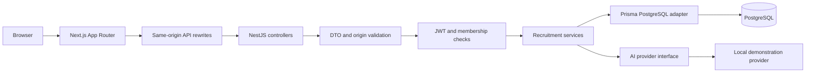

# Architecture

RecruitFlow is a pnpm monorepo containing a Next.js frontend, a NestJS REST API, and a shared TypeScript contract package. A modular monolith keeps deployment and debugging manageable for an individual developer.

## Module responsibilities

| Module        | Responsibility                                                                         |
| ------------- | -------------------------------------------------------------------------------------- |
| Auth          | Candidate registration, bcrypt login, short-lived JWT cookie, safe identity, logout    |
| Organizations | Current user's memberships, recruiter/owner authorization, scoped overview counts      |
| Jobs          | Public published roles and organization-authorized management                          |
| Applications  | Candidate ownership, duplicate protection, controlled stage changes                    |
| AI            | Authorized analysis orchestration, provider injection, persisted demonstration results |
| Prisma        | One API connection pool and application lifecycle cleanup                              |

The frontend groups business pages under features and App Router routes. A workspace provider loads the authenticated identity and membership list. Shared components render navigation, headers, tables, statuses and loading/error/empty states. The browser never receives database credentials or JWT values in JavaScript.

## Authentication and authorization

Login sets a 15-minute `access_token` cookie, scoped to `/api`, with HttpOnly and SameSite=Strict. Production adds Secure. The API verifies signature and expiry and checks that the subject still exists. All state-changing routes require the configured exact WEB_ORIGIN, including login and logout. The Next.js proxy preserves same-origin browser requests; command-line clients must supply that Origin explicitly.

Platform ADMIN and organization OWNER/RECRUITER are separate enums. There is no automatic platform-admin bypass. Public registration cannot assign roles or memberships. Organization administration and invitation flows remain deferred.

Tenant data follows `application -> job -> organization`. Recruiter reads and writes check membership against that relationship. Candidate lists filter by the authenticated user, never a client-provided user ID. Public job responses explicitly select job/company fields and omit applicant data. Application uniqueness is enforced by PostgreSQL. Stage changes use a transaction and compare the previous status to detect concurrent updates.

These are application-level isolation controls, not PostgreSQL row-level security. Direct database access must remain privileged. Tests use two organizations and separate candidate identities to exercise isolation.

## AI flow

The AI controller accepts only an application UUID. The service loads its organization, authorizes the caller, then obtains job requirements and optional parsed resume context for the injected provider. `AIProvider` is the extension point; `MockAIProvider` ignores this context and returns fixed synthetic examples with `demonstration: true`. No resume is read, no external API is called, and no application status is changed. Results are saved in AIAnalysis with a demonstration warning in the summary.

A future adapter can implement the provider contract without changing recruitment stages or controllers. Enabling external processing also requires consent, reviewed extraction, privacy controls, timeouts, provider configuration validation and provenance records; provider injection alone does not satisfy those requirements.

## Deployment and limits

Docker Compose currently runs PostgreSQL only. Build produces a Next.js server and compiled NestJS application. Deploy both behind an HTTPS reverse proxy and keep PostgreSQL private. Set NODE_ENV=production, a fresh JWT_SECRET, the exact HTTPS WEB_ORIGIN and a private API_TARGET. The API binds to loopback; container deployment will need an explicit networking adjustment.

API middleware adds request validation, Helmet, no-store responses, same-origin write protection and in-memory rate limits. Frontend responses include anti-framing, MIME sniffing, referrer and permissions headers. Secrets and generated output are ignored by Git.

This starter has no refresh sessions, copied-token revocation, password reset, verified emails, audit trail, distributed rate limits, complete CSP, managed backups or production deployment. Logout clears the cookie but cannot invalidate a copied JWT before expiry. See the roadmap for the remaining production work.
