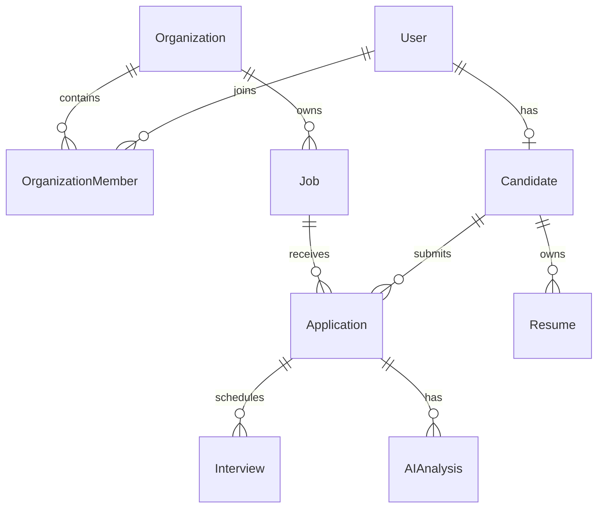

# Database foundation

Prisma 7 uses `prisma.config.ts` for the connection URL and the PostgreSQL driver adapter at runtime. The generated client is ignored and regenerated with `pnpm db:generate`. Commit schema and migration SQL, never generated client files.

| Model              | Key constraints                                                          |
| ------------------ | ------------------------------------------------------------------------ |
| User               | UUID, unique normalized email, bcrypt hash, platform role                |
| Organization       | UUID, unique slug                                                        |
| OrganizationMember | Unique userId/organizationId; OWNER or RECRUITER                         |
| Job                | Required organization; controlled employment type and publication status |
| Candidate          | Unique userId, optional phone                                            |
| Application        | Unique jobId/candidateId; controlled stage enum                          |
| Resume             | Candidate owner, unique private file key, optional JSON parsing data     |
| Interview          | Application reference, schedule, controlled status                       |
| AIAnalysis         | Application reference and reviewable summary/skills                      |

Organization/job/candidate/application deletion is restricted where it would destroy recruitment history. Memberships cascade with the parent. Resumes cascade with candidates, analyses with applications. No deletion endpoint removes users, candidates, organizations, or applications in this scope.

Indexes support organization job lists, public published lists, candidate application lists, and child lookups. Composite unique constraints enforce membership and application uniqueness at the database boundary, including concurrent inserts.

Tenant access is enforced in NestJS using authenticated user membership and relations to the job organization. Candidate reads use the authenticated identity. There is no database RLS policy in this starter; direct database access remains privileged.

`pnpm db:migrate` uses migrate deploy, never a reset. Seed upserts known synthetic records and preserves existing passwords and data. Existing PostgreSQL volume identity is unchanged from the original Compose setup.
